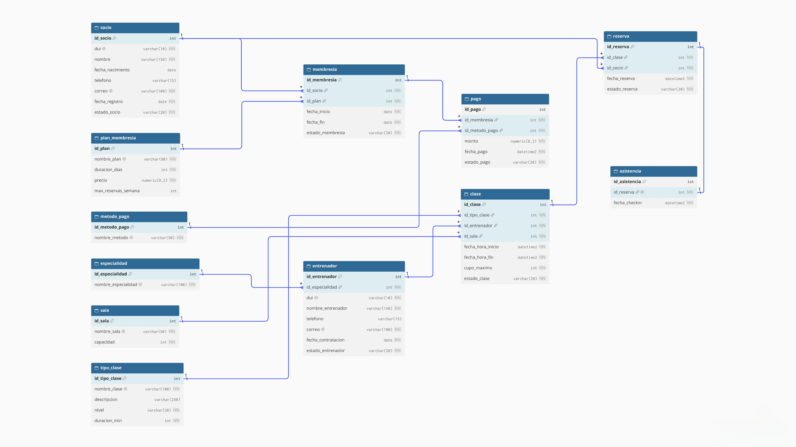

# Sistema de Reservas de Gimnasio

**Proyecto de Cátedra: Administración de Bases de Datos con SQL Server 2025**

Base de datos para gestionar socios, membresías, pagos, entrenadores, clases, reservas y asistencia de un gimnasio. Incluye diseño relacional en 3FN, seguridad por roles, auditoría, optimización con índices y funciones ventana, estrategia de respaldo con RPO y RTO, jobs de SQL Server Agent y un dashboard en Power BI.

## Integrantes

| Integrante | Rol |
|---|---|
| Integrante 1 | *Barrera Contreras, Fernando José* |
| Integrante 2 | *López Gúzman, Anthony Odir* |
| Integrante 3 | *Méndez Marenco, Alejandro Antonio* |
| Integrante 4 | *Peraza Navas, William Eduardo* |

## Tecnologías

| Herramienta | Uso |
|---|---|
| SQL Server 2025 Developer (Docker) | Motor de base de datos |
| T-SQL | Scripts, procedimientos, triggers y vistas |
| SQL Server Agent | Jobs de respaldo y mantenimiento |
| dbdiagram.io | Diagrama entidad-relación |
| Power BI Desktop | Dashboard conectado a SQL Server |

## Entregables de la cátedra

| Entregable | Ubicación |
|---|---|
| Informe (PDF) | [`informe/informe_final_gimnasio.pdf`](informe/informe_final_gimnasio.pdf) |
| Script SQL | [`sql/`](sql/) (scripts numerados y `script_completo.sql`) |
| Dashboard Power BI | [`powerbi/dashboard_gimnasio.pbix`](powerbi/dashboard_gimnasio.pbix) |
| Presentación | [`docs/defensa_proyecto_final.pptx`](docs/defensa_proyecto_final.pptx) |

## Estructura del repositorio

```
gimnasio-adminbd/
├── README.md
├── .gitignore
├── .gitattributes
├── informe/
│   └── informe_final_gimnasio.pdf
├── docs/
│   ├── diagrama_er_gimnasio.jpeg
│   ├── diccionario_datos.md
│   ├── matriz_seguridad.md
│   ├── dimensionamiento.md
│   ├── estrategia_backup.md
│   └── defensa_proyecto_final.pptx
├── sql/
│   ├── 01_crear_bd_y_esquemas.sql
│   ├── 02_crear_tablas.sql
│   ├── 03_1_carga_datos.sql
│   ├── 04_seguridad_roles_usuarios.sql
│   ├── 05_auditoria.sql
│   ├── 06_indices.sql
│   ├── 07_consultas_avanzadas.sql
│   ├── 08_backup_restore.sql
│   ├── 09_jobs_sql_agent.sql
│   ├── 10_vistas_reportes.sql
└── powerbi/
    └── dashboard_gimnasio.pbix
```

## Modelo de datos



12 tablas normalizadas hasta tercera forma normal, organizadas en esquemas según su función. Cada esquema corresponde a un área de acceso distinta:

| Esquema | Tablas | Propósito |
|---|---|---|
| `socios` | `socio`, `plan_membresia`, `membresia` | Clientes y sus membresías |
| `finanzas` | `metodo_pago`, `pago` | Cobros e ingresos |
| `clases` | `sala`, `tipo_clase`, `clase`, `reserva`, `asistencia` | Operación diaria |
| `personal` | `especialidad`, `entrenador` | Equipo de entrenadores |
| `auditoria` | `log_pago` | Bitácora de cambios en pagos |
| `reportes` | Vistas | Capa de lectura para Power BI |

Detalle de columnas, tipos y restricciones: [`docs/diccionario_datos.md`](docs/diccionario_datos.md).

## Requisitos

- Docker con la imagen de SQL Server 2025 (edición Developer).
- Un cliente SQL: `sqlcmd`, Azure Data Studio o SSMS.
- Power BI Desktop (solo para abrir el dashboard).

## Puesta en marcha

### 1. Levantar SQL Server en Docker

Los scripts de auditoría y respaldo escriben en `/audit` y `/backup` dentro del contenedor, y los jobs requieren SQL Server Agent. El siguiente comando es un ejemplo; ajústenlo a su entorno:

```bash
docker run -d --name sqlserver-gym \
  -e "ACCEPT_EULA=Y" \
  -e "MSSQL_SA_PASSWORD=<contraseña_segura>" \
  -e "MSSQL_PID=Developer" \
  -e "MSSQL_AGENT_ENABLED=true" \
  -p 1433:1433 \
  -v gym_backup:/backup \
  -v gym_audit:/audit \
  mcr.microsoft.com/mssql/server:2025-latest
```

Crear las carpetas de trabajo y darle permisos al usuario `mssql`:

```bash
docker exec -u 0 sqlserver-gym bash -c "mkdir -p /backup/GimnasioDB /audit/GimnasioDB && chown -R mssql /backup /audit"
```

### 2. Ejecutar los scripts

Conectarse a `localhost,1433` con el usuario `sa` y ejecutar los scripts **en orden**, cada uno completo. Con `sqlcmd` desde la carpeta del repositorio:

```bash
sqlcmd -S localhost,1433 -U sa -P "<contraseña_segura>" -C -b -f 65001 -i sql/01_crear_bd_y_esquemas.sql
```

Repetir el comando cambiando el archivo, o ejecutar todo de una vez con `sql/script_completo.sql`.

| Orden | Script | Qué hace |
|---|---|---|
| 1 | `01_crear_bd_y_esquemas.sql` | Crea `GimnasioDB` (recuperación FULL) y los 6 esquemas. Recrea la base si ya existe. |
| 2 | `02_crear_tablas.sql` | Crea las 12 tablas con sus restricciones, un trigger y dos procedimientos con las reglas de negocio. |
| 3 | `03_1_carga_datos.sql` | Carga catálogos y genera datos de prueba de forma determinística (200 socios, membresías, pagos, clases, reservas y asistencias). |
| 4 | `04_seguridad_roles_usuarios.sql` | Crea logins, usuarios y roles por función, con pruebas de permisos permitidos y denegados. |
| 5 | `05_auditoria.sql` | Configura SQL Server Audit, la auditoría de base de datos y la bitácora de pagos. |
| 6 | `06_indices.sql` | Crea los índices de optimización y pruebas rápidas con plan de ejecución. |
| 7 | `07_consultas_avanzadas.sql` | Ejecuta las 3 consultas con funciones ventana. |
| 8 | `08_backup_restore.sql` | Demuestra respaldo completo, diferencial y de log, y restauración a una base nueva. |
| 9 | `09_jobs_sql_agent.sql` | Crea los 5 jobs de SQL Server Agent con su calendario y los ejecuta como prueba. |
| 10 | `10_vistas_reportes.sql` | Crea las vistas del esquema `reportes` que consume Power BI. |

**Importante:**
- Ejecutar `08` **antes** que `09`: si los jobs de log ya corren, interrumpen la cadena de respaldos de la demostración.
- `04` se ejecuta una sola vez por base de datos (si se repite, falla al crear usuarios). Para repetir, volver a correr desde el `01`.
- Los datos son ficticios y reproducibles: todos los integrantes obtienen el mismo resultado.

### 3. Verificar la instalación

Al terminar el script `03_1`, las 4 consultas de validación de reglas de negocio (sección 10) deben devolver **0 filas**: sin sobrecupo, sin reservas sin membresía válida, sin excesos del límite semanal y sin clases traslapadas.

## Seguridad

Cuatro roles por función, con mínimo privilegio. Las contraseñas de los logins están en `04_seguridad_roles_usuarios.sql` y son solo de práctica.

| Rol | Usuario | Acceso |
|---|---|---|
| `rol_recepcion` | `usr_recepcion` | Socios, membresías y cobros. Las reservas solo mediante procedimientos. |
| `rol_entrenador` | `usr_entrenador` | Consulta de clases y reservas; registra asistencia. De los socios solo ve `id_socio` y `nombre`. |
| `rol_finanzas` | `usr_finanzas` | Pagos y consulta de membresías. Nunca elimina pagos. |
| `rol_reportes` | `usr_powerbi` | Solo lectura sobre el esquema `reportes`. |

La matriz completa y la auditoría están en [`docs/matriz_seguridad.md`](docs/matriz_seguridad.md).

## Respaldo y recuperación

| Tipo | Frecuencia |
|---|---|
| Completo | Semanal |
| Diferencial | Diario (lunes a sábado) |
| Log de transacciones | Cada 15 minutos |
| Verificación de integridad (`CHECKDB`) | Semanal |
| Limpieza de respaldos antiguos | Semanal |

Objetivos: **RPO de 15 minutos** y **RTO de 30 minutos**. Detalle y procedimientos de recuperación en [`docs/estrategia_backup.md`](docs/estrategia_backup.md).

## Dashboard en Power BI

El dashboard se conecta a SQL Server con el usuario de solo lectura `lg_powerbi` y consume únicamente las vistas del esquema `reportes`.

1. Abrir `powerbi/dashboard_gimnasio.pbix`.
2. Si pide credenciales: servidor `localhost,1433`, base de datos `GimnasioDB`, autenticación de base de datos con `lg_powerbi`.
3. Actualizar los datos.

La guía para reconstruirlo (modelo, medidas DAX, visuales y filtros) está en [`docs/guia_dashboard_powerbi.md`](docs/guia_dashboard_powerbi.md).

## Documentación

| Documento | Contenido |
|---|---|
| [`docs/diccionario_datos.md`](docs/diccionario_datos.md) | Tablas, columnas, restricciones y esquemas |
| [`docs/matriz_seguridad.md`](docs/matriz_seguridad.md) | Roles, privilegios y auditoría |
| [`docs/dimensionamiento.md`](docs/dimensionamiento.md) | Cálculo de tamaño por tabla, factor por índices y proyección a 5 años |
| [`docs/estrategia_backup.md`](docs/estrategia_backup.md) | Estrategia de respaldo, RPO/RTO y recuperación |
| [`docs/guia_dashboard_powerbi.md`](docs/guia_dashboard_powerbi.md) | Guía del dashboard |

## Cobertura de los criterios de evaluación

| Criterio | Dónde se cubre |
|---|---|
| Diseño y documentación de la base de datos | `docs/diagrama_er_gimnasio.jpeg`, `docs/diccionario_datos.md` |
| Carga de datos | `sql/03_1_carga_datos.sql` |
| Seguridad (usuarios, roles, esquemas, auditoría) | `sql/04`, `sql/05`, `docs/matriz_seguridad.md` |
| Dimensionamiento | `docs/dimensionamiento.md` |
| Consultas avanzadas, funciones ventana e índices | `sql/06`, `sql/07` |
| Respaldo, RPO/RTO y jobs en SQL Agent | `sql/08`, `sql/09`, `docs/estrategia_backup.md` |
| Dashboard en Power BI | `sql/10`, `powerbi/`, `docs/guia_dashboard_powerbi.md` |
| Informe y defensa | `informe/`, `docs/defensa_proyecto_final.pptx` |

## Nota académica

Proyecto desarrollado para la asignatura Administración de Bases de Datos. Todos los datos son ficticios.
